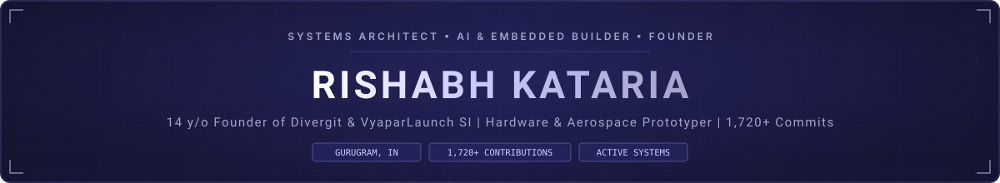

<!-- Custom Vector Header Banner -->

<!-- Dynamic Animated Typing Title in #CCCCFF with Space Grotesk -->

  
  
  
  
  
  

---

### About Me

I am a **student founder and systems engineer** based in Gurugram, India. I focus on turning complex technical concepts into production-grade reality—operating commercial SaaS monorepos, building autonomous voice pipelines, and fabricating assistive embedded hardware.

- **Founder @ VyaparLaunch SI:** Commercial SaaS monorepo automating Google Business review intelligence and WhatsApp damage control for SMBs.
- **Founder @ Divergit ([divergit.com](https://divergit.com)):** Autonomous B2B workflow orchestration and conversational voice AI agency.
- **Digital & Tech Lead @ VOLTMEN:** Powering corporate platforms ([voltmensolar.com](https://voltmensolar.com), [voltmenenergy.com](https://voltmenenergy.com)) and lead acquisition funnels for industrial CleanTech.
- **Embedded & Hardware Engineering:** Conceived and engineered the **Setu Smart Navigation Cane** (dual-height ultrasonic obstacle detection with haptics for BIC 2.0) and aerodynamically designed lightweight foaming **VTOL RC aircraft** in SolidWorks.
- **Mathematical Rigor:** Active algorithmic Olympiad preparation in Number Theory, Combinatorics, and Geometry for **IOQM, ZCO, and ZIO**.

---

### GitHub Analytics & Velocity

<!-- Real-time Contribution Graph Tinted to #A3A3CC -->

  

<!-- Cohesive Activity Stats Cards -->

  
  

---

### Flagship Systems & Ventures

<table>
  <tr>
    <td width="50%" valign="top">
      <h3>VyaparLaunch SI</h3>
      
<b>Review Intelligence & WhatsApp Damage Control Monorepo</b>

      <ul>
        <li>Real-time Google Cloud Pub/Sub review ingestion from Google Business Profile API.</li>
        <li>Gemini 2.5 drafts multilingual replies; auto-publishes positive 4–5★ reviews.</li>
        <li>Intercepts critical 1–3★ negative feedback directly to owner's WhatsApp with interactive action buttons.</li>
        <li>Automated seasonal festival banners stored on Cloudflare R2; Razorpay UPI recurring billing.</li>
      </ul>
      
<b>Stack:</b> <code>Turborepo</code> <code>TypeScript</code> <code>Fastify</code> <code>Prisma</code> <code>PostgreSQL</code> <code>Redis/BullMQ</code> <code>Gemini AI</code>

    </td>
    <td width="50%" valign="top">
      <h3>Divergit Agency</h3>
      
<b>Autonomous Workflow & Conversational Voice AI</b> (<a href="https://divergit.com">divergit.com</a>)

      <ul>
        <li>Autonomous inbound/outbound telephony agents on Vapi.ai and ElevenLabs with dynamic CRM tool calling.</li>
        <li>Multi-stage WhatsApp Business API lead qualification and nurturing funnels.</li>
        <li>Fault-tolerant Python webhooks and enterprise automations eliminating manual friction.</li>
      </ul>
      
<b>Stack:</b> <code>n8n</code> <code>Make.com</code> <code>Python</code> <code>Vapi.ai</code> <code>ElevenLabs</code> <code>WhatsApp Cloud API</code>

    </td>
  </tr>
  <tr>
    <td width="50%" valign="top">
      <h3>Setu (Smart Navigation Cane)</h3>
      
<b>Assistive Embedded Hardware (Bharat Innovation Challenge 2.0)</b>

      <ul>
        <li>Dual-tier HC-SR04 ultrasonic sensors eliminating ground and chest-level blind spots.</li>
        <li>Variable PWM haptic vibration escalation mapped to distance and hazard height.</li>
        <li>Rugged 20mm PVC chassis with custom 3D-printed mounts; BOM under ₹1,200 ($14).</li>
      </ul>
      
<b>Stack:</b> <code>Arduino Nano</code> <code>Dual HC-SR04</code> <code>PWM Haptics</code> <code>SolidWorks</code> <code>FDM 3D Printing</code>

    </td>
    <td width="50%" valign="top">
      <h3><a href="https://github.com/nova-rishabh/Credipro">Credipro (Midnight Network)</a></h3>
      
<b>Zero-Knowledge Uncollateralized DeFi Lending</b>

      <ul>
        <li>Solves uncollateralized lending via zero-knowledge credit proofs (zk-SNARKs).</li>
        <li>Borrowers prove solvency on-chain without exposing private balance data.</li>
        <li>2-of-3 decentralized oracle consensus decrypts identity strictly upon default under legal MLA.</li>
      </ul>
      
<b>Stack:</b> <code>Midnight SDK</code> <code>Compact</code> <code>TypeScript</code> <code>Express</code> <code>React</code> <code>Docker</code>

    </td>
  </tr>
  <tr>
    <td width="50%" valign="top">
      <h3><a href="https://github.com/nova-rishabh/civicgrid-ai">CivicGrid-AI</a></h3>
      
<b>Smart Microgrid Forecasting &amp; Power Allocation</b>

      <ul>
        <li>Scikit-Learn ML models forecast real-time solar irradiance and kinetic foot-traffic generation.</li>
        <li>Simplex Linear Programming (PuLP) solves multi-variable power allocation constraints.</li>
        <li>Guarantees 100% continuous power uptime to emergency and life-safety medical loads.</li>
      </ul>
      
<b>Stack:</b> <code>Python</code> <code>Streamlit</code> <code>Scikit-learn</code> <code>PuLP (LP)</code> <code>Plotly</code> <code>Pandas</code>

    </td>
    <td width="50%" valign="top">
      <h3>F.R.I.D.A.Y Voice AI Suite</h3>
      
<b>Desktop OS Automation via Model Context Protocol (FastMCP)</b>

      <ul>
        <li>Suite of 6 voice AI and Windows OS automation agents.</li>
        <li>Custom FastMCP server allowing LLMs to inspect processes, manage files, and execute macros.</li>
        <li>Real-time WebRTC LiveKit audio streaming, Faster-Whisper STT, and ChromaDB vector memory.</li>
      </ul>
      
<b>Stack:</b> <code>FastMCP</code> <code>Python</code> <code>FastAPI</code> <code>LiveKit Agents</code> <code>Claude API</code> <code>Gemini</code> <code>ChromaDB</code>

    </td>
  </tr>
</table>

---

### Technical Competencies & Software Tools

| Domain | Technologies & Software |
|---|---|
| **Core Languages** | `TypeScript` (73%) • `Python` (12%) • `JavaScript` (10%) • `C++` (Arduino Wire) • `SQL` • `Compact` |
| **Mechanical CAD & 3D Printing** | `SolidWorks` • `OrcaSlicer` • `PrusaSlicer` • `Blender` • Foaming LW-PLA & PETG Manufacturing |
| **AI, Voice & Agents** | `Google Gemini API` • `Anthropic Claude API` • `FastMCP` • `LiveKit WebRTC` • `Vapi.ai` • `ElevenLabs` • `ChromaDB` |
| **Full-Stack & Cloud Architecture** | `Next.js 15` • `React 19` • `Fastify` • `Turborepo` • `Prisma ORM` • `PostgreSQL` • `Redis` • `BullMQ` • `Docker` |
| **Workflow Automation & APIs** | `n8n` • `Make.com` • `WhatsApp Business Cloud API` • `Google Cloud Pub/Sub` • `Razorpay UPI Autopay` |
| **Embedded Systems & Hardware** | `Arduino Nano` • `ESP32` • `HC-SR04 Ultrasonics` • `PWM Haptics` • `L7805CV Power Regulators` |
| **Web3 & Cryptography** | `Midnight Network SDK` • `Compact Smart Contracts` • `zk-SNARKs (BLS12-381)` • `Oracle Consensus` |

---

### Complete Project Archive (20 Audited Builds)

| # | Project Name | Domain / Category | Primary Tech Stack | Status / Link |
|---|---|---|---|---|
| 01 | **VyaparLaunch SI** | Commercial SaaS Monorepo | Turborepo, Fastify, Gemini 2.5, WhatsApp API, Redis | Proprietary / Production |
| 02 | **Divergit Agency** | B2B Workflow Automations | n8n, Make.com, Python, Vapi.ai, ElevenLabs | [divergit.com](https://divergit.com) |
| 03 | **Setu (Smart Navigation Cane)** | Assistive Hardware | Arduino Nano, Dual HC-SR04, Haptics, PVC | BIC 2.0 Submission |
| 04 | [**Credipro**](https://github.com/nova-rishabh/Credipro) | Zero-Knowledge DeFi | Midnight SDK, Compact (zk-SNARKs), Express, React | [GitHub](https://github.com/nova-rishabh/Credipro) |
| 05 | [**CivicGrid-AI**](https://github.com/nova-rishabh/civicgrid-ai) | Smart Grid Optimization | Python, Streamlit, Scikit-learn, PuLP (LP) | [GitHub](https://github.com/nova-rishabh/civicgrid-ai) |
| 06 | **F.R.I.D.A.Y Voice AI Suite** | Systems AI & MCP Tools | FastAPI, FastMCP, LiveKit, Claude, ChromaDB | Working Suite |
| 07 | **EchoBind** | Edge AI & Signal Processing | Python, PyAudio, Librosa (MFCC), Scikit-Learn | Internal Tool |
| 08 | [**VOLTMEN Solar**](https://voltmensolar.com) | Corporate Web Platform | Next.js 15, React 19, TypeScript, Tailwind CSS v4 | [voltmensolar.com](https://voltmensolar.com) |
| 09 | [**VOLTMEN Energy**](https://voltmenenergy.com) | Industrial Web Platform | Web Infrastructure, Structured Schema, SEO | [voltmenenergy.com](https://voltmenenergy.com) |
| 10 | **Foam-Cored VTOL RC Aircraft** | Aerospace Hardware | Foaming LW-PLA, PETG, Brushless Motors, CAD | Prototype Built |
| 11 | [**Omniversal-AI**](https://github.com/nova-rishabh/Omniversal-AI) | Generative AI Web App | Next.js 16, React 19, Google Gemini, Framer Motion | [omniversal-ai.vercel.app](https://omniversal-ai.vercel.app) |
| 12 | [**NeuroCast**](https://github.com/nova-rishabh/NeuroCast) | NLP / Data Science | JavaScript, Node.js, NLP Classification Pipelines | [GitHub](https://github.com/nova-rishabh/NeuroCast) |
| 13 | **PolluGone** | CleanTech Materials | Titanium Dioxide Photocatalysis, Market Analytics | Eureka! Junior |
| 14 | **Non-Profit Learning Support** | Cognitive Accessibility | Client-Side Architecture, Privacy Screeners | Live Platform |
| 15 | **PulseAI** | Multi-Agent Intelligence | Python, Multi-Agent Systems, Web Scraping | Hackathon Project |
| 16 | **JARVIC** | Conversational Companion | Python, `speech_recognition`, `pyttsx3`, APIs | Archived Core |
| 17 | **Hack for Hackers** | Hackathon Engine | Next.js 16, Playwright, ScrapeGraph, Jules AI | Internal Tool |
| 18 | **Surya Mitr** | Solar Enterprise System | 3-Tier Enterprise Blueprint (Firebase/FlutterFlow) | Enterprise Spec |
| 19 | **Bijli Kart** | Industrial E-Commerce | Shopify, Catalog Management | Managed Store |
| 20 | **CrisisLens** | Computer Vision Research | Python, Computer Vision, Geospatial Indexing | Research Workspace |

---

### Competitions, Hackathons & Honors

- 💡 **Bharat Innovation Challenge 2.0 (BIC):** Conceived and engineered the Setu Smart Navigation Cane with Team Nova.
- 🌐 **Participant — Midnight Network Web3 Hackathon (2026):** Developed Credipro zero-knowledge lending protocol.
- 🤖 **Deployment — AI Hackfest 2026:** Developed and deployed Omniversal-AI ([omniversal-ai.vercel.app](https://omniversal-ai.vercel.app)).
- 📈 **Datathon — NeuroLogic '26:** Engineered multi-challenge NLP classification pipelines with NeuroCast.
- 🌱 **Eureka! Junior:** Presented PolluGone photo-catalytic air-purifying architectural panels.
- 📐 **Olympiad Pipeline:** Intensive mathematical preparation in Number Theory, Combinatorics, and Plane Geometry for **IOQM, ZCO, and ZIO**.
- 🎓 **Young CEO Program:** Completed entrepreneurship and venture leadership immersion at IIT Delhi.

---

### Connect & Collaborate

  
  
  
  

